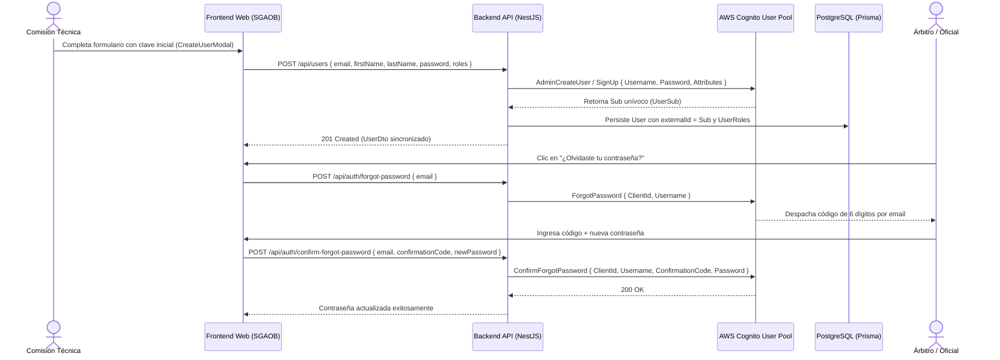

# Informe de Avance — PR21: Aprovisionamiento en AWS Cognito, Recuperación de Contraseña por Correo y Gestión de Perfil

**Fecha de Cierre:** 24 de Octubre de 2026  
**Proyecto:** SGAOB (Sistema de Gestión de Árbitros y Oficiales de Básquetbol)  
**Alcance:** apps/api, apps/web, docs  
**Estado:** Completado y Verificado 100%

---

## 1. Resumen Ejecutivo del Hito

En este hito se implementaron dos capacidades críticas para la operación deportiva y la seguridad de cuentas en SGAOB:

1. **Aprovisionamiento Inmediato en AWS Cognito:** Al crear un árbitro u oficial de mesa desde la Comisión Técnica (`UsersManagementPage` -> `CreateUserModal`), el sistema crea sincronizadamente al usuario en AWS Cognito User Pool (usando API Administrativa con firma AWS SigV4 nativa si existen credenciales IAM, o `SignUp` con `ClientId` público). El oficial queda con su contraseña inicial fijada (o predeterminada `Temporal2026!`) y su identificador unívoco `sub` vinculado de inmediato en PostgreSQL, permitiéndole autenticarse en el acto.
2. **Flujo Completo de Recuperación de Contraseña por Correo:** Se implementaron los endpoints `POST /api/auth/forgot-password` y `POST /api/auth/confirm-forgot-password`. En el frontend oficial de Cognito (`LoginPage.tsx`), se integró el enlace y modal interactivo "¿Olvidaste tu contraseña?" de 2 pasos: solicitud de código de 6 dígitos despachado al correo y restablecimiento seguro con validación de requisitos de complejidad.
3. **Módulo de Modificación de Perfil de Usuario y Cambio de Contraseña:** Se habilitó la vista protegida [`ProfilePage.tsx`](file:///c:/Users/mella/OneDrive/Documentos/Proyectos/CapstoneMain/apps/web/src/pages/ProfilePage.tsx) bajo la ruta `/perfil`, accesible desde la barra de navegación superior y menú móvil. Permite a cualquier usuario autenticado actualizar sus datos de contacto (nombre, apellido, teléfono), modificar su contraseña validando la clave actual contra AWS Cognito (`InitiateAuth` + `ChangePassword`), visualizar roles técnicos acreditados y confirmar el consentimiento informado de datos (Ley N° 19.628 / RF01).

---

## 2. Archivos y Componentes Modificados

| Componente / Archivo | Tipo de Cambio | Alcance y Propósito |
|---|---|---|
| [`apps/api/src/modules/users/dto/create-user.dto.ts`](file:///c:/Users/mella/OneDrive/Documentos/Proyectos/CapstoneMain/apps/api/src/modules/users/dto/create-user.dto.ts) | Modificación | Se añade campo opcional `password?: string` para definir contraseña inicial en Cognito. |
| [`apps/api/src/modules/auth/dto/forgot-password.dto.ts`](file:///c:/Users/mella/OneDrive/Documentos/Proyectos/CapstoneMain/apps/api/src/modules/auth/dto/forgot-password.dto.ts) | Nuevo | DTO de validación para solicitud de código de recuperación por correo. |
| [`apps/api/src/modules/auth/dto/confirm-forgot-password.dto.ts`](file:///c:/Users/mella/OneDrive/Documentos/Proyectos/CapstoneMain/apps/api/src/modules/auth/dto/confirm-forgot-password.dto.ts) | Nuevo | DTO para confirmación de código de 6 dígitos y nueva contraseña. |
| [`apps/api/src/modules/auth/dto/change-password.dto.ts`](file:///c:/Users/mella/OneDrive/Documentos/Proyectos/CapstoneMain/apps/api/src/modules/auth/dto/change-password.dto.ts) | Nuevo | DTO para cambio de contraseña autenticado (actual vs. nueva). |
| [`apps/api/src/modules/auth/dto/index.ts`](file:///c:/Users/mella/OneDrive/Documentos/Proyectos/CapstoneMain/apps/api/src/modules/auth/dto/index.ts) | Nuevo | Re-exportación unificada de DTOs del módulo auth. |
| [`apps/api/src/common/mail/mail.service.ts`](file:///c:/Users/mella/OneDrive/Documentos/Proyectos/CapstoneMain/apps/api/src/common/mail/mail.service.ts) | Modificación | Incorporación de métodos `sendPasswordResetCode` y `sendPasswordChangedAlert`. |
| [`apps/api/src/modules/auth/auth.service.ts`](file:///c:/Users/mella/OneDrive/Documentos/Proyectos/CapstoneMain/apps/api/src/modules/auth/auth.service.ts) | Modificación | Implementación de `createCognitoUser`, `forgotPassword`, `confirmForgotPassword` y `changePassword`. |
| [`apps/api/src/modules/auth/auth.controller.ts`](file:///c:/Users/mella/OneDrive/Documentos/Proyectos/CapstoneMain/apps/api/src/modules/auth/auth.controller.ts) | Modificación | Exposición de endpoints REST con Swagger para recuperación y cambio de contraseñas. |
| [`apps/api/src/modules/users/users.service.ts`](file:///c:/Users/mella/OneDrive/Documentos/Proyectos/CapstoneMain/apps/api/src/modules/users/users.service.ts) | Modificación | Inyección de `AuthService` para aprovisionar automáticamente usuarios en Cognito. |
| [`apps/api/src/modules/auth/auth.service.spec.ts`](file:///c:/Users/mella/OneDrive/Documentos/Proyectos/CapstoneMain/apps/api/src/modules/auth/auth.service.spec.ts) | Modificación | Cobertura de pruebas unitarias para creación en Cognito, reseteo y cambio de clave. |
| [`apps/api/src/modules/auth/auth.controller.spec.ts`](file:///c:/Users/mella/OneDrive/Documentos/Proyectos/CapstoneMain/apps/api/src/modules/auth/auth.controller.spec.ts) | Modificación | Tests unitarios para endpoints del controlador de autenticación. |
| [`apps/api/src/modules/users/users.service.spec.ts`](file:///c:/Users/mella/OneDrive/Documentos/Proyectos/CapstoneMain/apps/api/src/modules/users/users.service.spec.ts) | Modificación | Adaptación del mock de `AuthService` para verificación de creación de usuario. |
| [`apps/web/src/api/auth.api.ts`](file:///c:/Users/mella/OneDrive/Documentos/Proyectos/CapstoneMain/apps/web/src/api/auth.api.ts) | Modificación | Clientes HTTP tipados `forgotPassword`, `confirmForgotPassword` y `changePassword`. |
| [`apps/web/src/api/users.api.ts`](file:///c:/Users/mella/OneDrive/Documentos/Proyectos/CapstoneMain/apps/web/src/api/users.api.ts) | Modificación | Incorporación de `password` en la interfaz `CreateUserPayload`. |
| [`apps/web/src/pages/ProfilePage.tsx`](file:///c:/Users/mella/OneDrive/Documentos/Proyectos/CapstoneMain/apps/web/src/pages/ProfilePage.tsx) | Nuevo | Vista de gestión de perfil, seguridad y consentimiento informado. |
| [`apps/web/src/App.tsx`](file:///c:/Users/mella/OneDrive/Documentos/Proyectos/CapstoneMain/apps/web/src/App.tsx) | Modificación | Enrutamiento protegido de `/perfil` con lazy loading. |
| [`apps/web/src/components/layout/Navbar.tsx`](file:///c:/Users/mella/OneDrive/Documentos/Proyectos/CapstoneMain/apps/web/src/components/layout/Navbar.tsx) | Modificación | Enlace a perfil en avatar de usuario y menú de navegación responsive. |
| [`apps/web/src/components/users/CreateUserModal.tsx`](file:///c:/Users/mella/OneDrive/Documentos/Proyectos/CapstoneMain/apps/web/src/components/users/CreateUserModal.tsx) | Modificación | Campo de contraseña inicial configurable con toggle de visibilidad. |
| [`apps/web/src/pages/LoginPage.tsx`](file:///c:/Users/mella/OneDrive/Documentos/Proyectos/CapstoneMain/apps/web/src/pages/LoginPage.tsx) | Modificación | Modal y flujo interactivo de 2 pasos para recuperación de contraseña. |

---

## 3. Arquitectura y Flujos Técnicos



---

## 4. Trazabilidad con Requerimientos Funcionales

| Código RF | Requerimiento Funcional | Estado | Evidencia de Implementación |
|---|---|---|---|
| **RF01** | Autenticación, Gestión de Sesión y Consentimiento Informado | **Cumplido** | Recuperación de contraseñas por correo electrónico (`/api/auth/forgot-password`, `/api/auth/confirm-forgot-password`), cambio de contraseña seguro en perfil (`/api/auth/change-password`), y confirmación de consentimiento informado (`/api/users/consent`). |
| **RF03** | Administración y Estados de Cuenta del Padrón de Usuarios | **Cumplido** | Aprovisionamiento síncrono en AWS Cognito User Pool al crear cuentas desde la Comisión Técnica (`UsersService.createUser`), garantizando disponibilidad operativa inmediata. |

---

## 5. Evidencia Verificable de Funcionamiento (Protocolo Pre-Commit)

### 1. Compilación Frontend / Monorepo (`npm run build:web`)
```bash
> @sgaob/shared@1.0.0 build
> tsc
> @sgaob/web@1.0.0 build
> tsc && vite build
✓ 1675 modules transformed.
✓ built in 3.81s
Resultado: Exitoso (0 errores).
```

### 2. Verificación de Tipos del Backend (`npx tsc --noEmit -p apps/api/tsconfig.json`)
```bash
Resultado: Exitoso (0 errores de TypeScript en apps/api).
```

### 3. Verificación de Linter y Tipos Frontend (`npm run lint --prefix apps/web`)
```bash
> @sgaob/web@1.0.0 lint
> tsc --noEmit
Resultado: Exitoso (0 errores, 0 advertencias, 0 imports huérfanos).
```

### 4. Pruebas Unitarias de Backend (`npm run test --prefix apps/api`)
```text
Test Suites: 18 passed, 18 total
Tests:       136 passed, 136 total (aumentado de 128 a 136)
Snapshots:   0 total
Time:        12.947 s
Resultado: 100% pasando (0 fallos).
```

