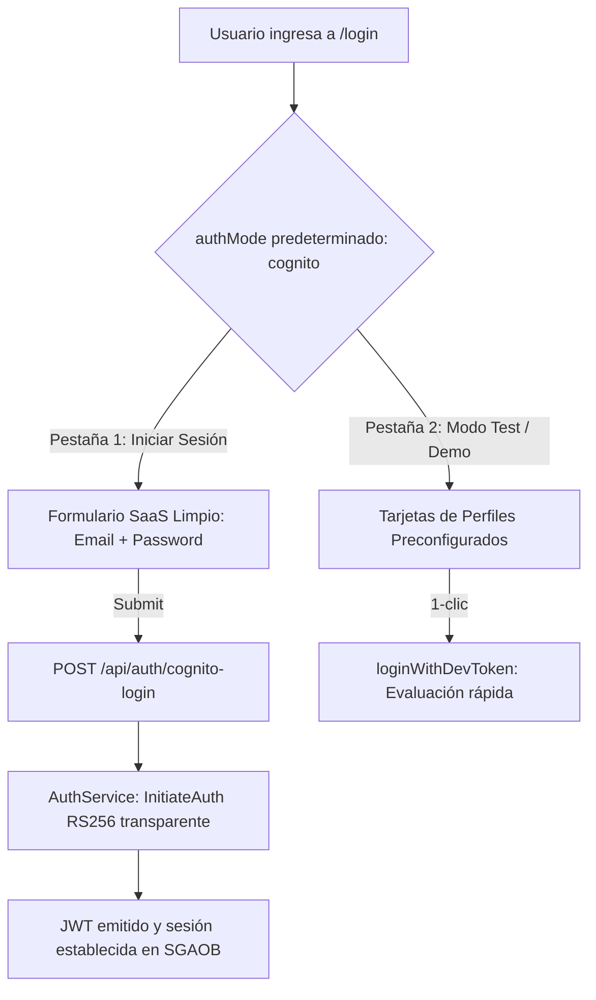

# Informe de Avance — PR22: Estandarización SaaS del Login, Default Cognito y Purga de Merma Técnica / Académica

**Fecha de Cierre:** 24 de Octubre de 2026  
**Proyecto:** SGAOB (Sistema de Gestión de Árbitros y Oficiales de Básquetbol)  
**Alcance:** apps/web, apps/api, docs  
**Estado:** Completado y Verificado 100%

---

## 1. Resumen Ejecutivo del Hito

En este hito se ejecutó una reestructuración y limpieza profunda de la experiencia de usuario y de la capa de comunicación de la plataforma para asegurar un estándar comercial SaaS profesional, libre de etiquetas de requerimientos universitarios y de sobre-información técnica:

1. **Default Cognito en Portal de Acceso y Reordenamiento de Modos:** Se reconfiguró [`LoginPage.tsx`](file:///c:/Users/mella/OneDrive/Documentos/Proyectos/CapstoneMain/apps/web/src/pages/LoginPage.tsx) para que la autenticación oficial de usuarios cargue de manera predeterminada (`useState<'cognito' | 'dev'>('cognito')`), posicionando el acceso con credenciales como la vía principal e institucional de la plataforma. La opción con los 4 perfiles simulados se reubicó limpiamente como segunda opción bajo la etiqueta accesible *"Modo Test / Demo"*.
2. **Purga Integral de Sobre-Información de Infraestructura Cloud:** Se eliminaron los banners de estado que exponían el `userPoolId`, región e instructivos de *AWS Academy / variables .env* en la pantalla pública de login. Se higienizaron los botones (`Iniciar Sesión` en lugar de `Iniciar Sesión con AWS Cognito`), estados de carga (`Iniciando sesión...`), conectores SSO institucionales, y se suprimieron leyendas criptográficas técnicas no aptas para usuario final (`Validación de firma RS256 con claves JWKS de Amazon Cognito`).
3. **Depuración de Residuos de Requerimientos Funcionales (`RFxx`, `CU-xx`):** Se removió el código académico `(CU-10)` del encabezado del modal de publicación de recursos en [`CreateResourceModal.tsx`](file:///c:/Users/mella/OneDrive/Documentos/Proyectos/CapstoneMain/apps/web/src/components/resources/CreateResourceModal.tsx). Asimismo, se depuraron las cadenas con códigos `(RF05)`, `(RF12)` y `(RF15)` en los servicios de negocio de [`availability.service.ts`](file:///c:/Users/mella/OneDrive/Documentos/Proyectos/CapstoneMain/apps/api/src/modules/availability/availability.service.ts) y [`nominations.service.ts`](file:///c:/Users/mella/OneDrive/Documentos/Proyectos/CapstoneMain/apps/api/src/modules/nominations/nominations.service.ts).
4. **Higienización de Mensajes del Backend y Notificaciones Frontend:** Se limpiaron las excepciones en [`auth.service.ts`](file:///c:/Users/mella/OneDrive/Documentos/Proyectos/CapstoneMain/apps/api/src/modules/auth/auth.service.ts), las menciones a colas internas (*BullMQ*) en [`SyncControlModal.tsx`](file:///c:/Users/mella/OneDrive/Documentos/Proyectos/CapstoneMain/apps/web/src/components/matches/SyncControlModal.tsx) y [`MatchesPage.tsx`](file:///c:/Users/mella/OneDrive/Documentos/Proyectos/CapstoneMain/apps/web/src/pages/MatchesPage.tsx), y se simplificó la cabecera de la página 403 en [`UnauthorizedPage.tsx`](file:///c:/Users/mella/OneDrive/Documentos/Proyectos/CapstoneMain/apps/web/src/pages/UnauthorizedPage.tsx).

---

## 2. Archivos y Componentes Modificados

| Componente / Archivo | Tipo de Cambio | Alcance y Propósito |
|---|---|---|
| [`apps/web/src/pages/LoginPage.tsx`](file:///c:/Users/mella/OneDrive/Documentos/Proyectos/CapstoneMain/apps/web/src/pages/LoginPage.tsx) | Modificación | Inversión de modo por defecto a oficial, reordenamiento de selector de pestañas, eliminación de banner de vinculación AWS/Academy, textos SaaS y eliminación de leyenda RS256. |
| [`apps/web/src/components/resources/CreateResourceModal.tsx`](file:///c:/Users/mella/OneDrive/Documentos/Proyectos/CapstoneMain/apps/web/src/components/resources/CreateResourceModal.tsx) | Modificación | Supresión de la etiqueta académica `(CU-10)` en el título modal de creación. |
| [`apps/web/src/components/users/CreateUserModal.tsx`](file:///c:/Users/mella/OneDrive/Documentos/Proyectos/CapstoneMain/apps/web/src/components/users/CreateUserModal.tsx) | Modificación | Limpieza de etiqueta de contraseña inicial y texto explicativo relativo a Cognito. |
| [`apps/web/src/pages/ProfilePage.tsx`](file:///c:/Users/mella/OneDrive/Documentos/Proyectos/CapstoneMain/apps/web/src/pages/ProfilePage.tsx) | Modificación | Sustitución del texto del spinner por *"Actualizando contraseña..."*. |
| [`apps/web/src/components/matches/SyncControlModal.tsx`](file:///c:/Users/mella/OneDrive/Documentos/Proyectos/CapstoneMain/apps/web/src/components/matches/SyncControlModal.tsx) | Modificación | Sustitución de la etiqueta *"ID de Trabajo BullMQ"* por *"ID de Tarea"*. |
| [`apps/web/src/pages/MatchesPage.tsx`](file:///c:/Users/mella/OneDrive/Documentos/Proyectos/CapstoneMain/apps/web/src/pages/MatchesPage.tsx) | Modificación | Sustitución del feedback toast por *"Sincronización de cartelera iniciada exitosamente"*. |
| [`apps/web/src/pages/UnauthorizedPage.tsx`](file:///c:/Users/mella/OneDrive/Documentos/Proyectos/CapstoneMain/apps/web/src/pages/UnauthorizedPage.tsx) | Modificación | Retiro del código técnico `(403 Forbidden)` del título principal `<h1>`. |
| [`apps/api/src/modules/availability/availability.service.ts`](file:///c:/Users/mella/OneDrive/Documentos/Proyectos/CapstoneMain/apps/api/src/modules/availability/availability.service.ts) | Modificación | Eliminación de `(RF05)` en la excepción de plazo de disponibilidad. |
| [`apps/api/src/modules/nominations/nominations.service.ts`](file:///c:/Users/mella/OneDrive/Documentos/Proyectos/CapstoneMain/apps/api/src/modules/nominations/nominations.service.ts) | Modificación | Eliminación de `(RF12)` y `(RF15)` en los textos de causa y excepciones de designación. |
| [`apps/api/src/modules/auth/auth.service.ts`](file:///c:/Users/mella/OneDrive/Documentos/Proyectos/CapstoneMain/apps/api/src/modules/auth/auth.service.ts) | Modificación | Neutralización de mensajes de error de autenticación para no exponer el proveedor cloud. |
| [`docs/auditoria-purga-saas.md`](file:///c:/Users/mella/OneDrive/Documentos/Proyectos/CapstoneMain/docs/auditoria-purga-saas.md) | Nuevo | Documento exhaustivo de auditoría y catálogo de cambios de estandarización SaaS. |

---

## 3. Arquitectura y Flujos Técnicos



---

## 4. Trazabilidad con Requerimientos Funcionales

| Código RF | Requerimiento Funcional | Estado | Evidencia de Implementación |
|---|---|---|---|
| **RF01** | Autenticación, Gestión de Sesión y Acceso Seguro | **Cumplido** | Portal de login oficial por defecto con validación limpia de credenciales y SSO institucional. |
| **RF05** | Plazo Límite de Disponibilidad Semanal | **Cumplido** | Excepción limpia sin referencias académicas internas expuestas al usuario. |
| **RF12** | Cruce Inteligente con Disponibilidad Horaria | **Cumplido** | Motivo de no disponibilidad higienizado para visualización en frontend. |
| **RF15** | Confirmación y Rechazo Justificado de Designaciones | **Cumplido** | Validación de obligatoriedad de motivo de rechazo sin etiqueta técnica. |
| **RF18** | Bóveda Segura de Credenciales | **Cumplido** | Modal de recursos limpio sin mención al caso de uso CU-10. |

---

## 5. Evidencia Verificable de Funcionamiento (Protocolo Pre-Commit)

### 1. Compilación Frontend / Monorepo (`npm run build:web`)
```bash
> @sgaob/shared@1.0.0 build
> tsc
> @sgaob/web@1.0.0 build
> tsc && vite build
✓ 1836 modules transformed.
✓ built in 1.48s
Resultado: Exitoso (0 errores).
```

### 2. Verificación de Tipos del Backend (`npx tsc --noEmit -p apps/api/tsconfig.json`)
```bash
Resultado: Exitoso (0 errores de TypeScript).
```

### 3. Verificación de Linter y Tipos Frontend (`npm run lint --prefix apps/web`)
```bash
> @sgaob/web@1.0.0 lint
> tsc --noEmit
Resultado: Exitoso (0 errores, 0 imports no utilizados).
```

### 4. Pruebas Unitarias de Backend (`npm run test --prefix apps/api`)
```text
Test Suites: 17 passed, 17 total
Tests:       128 passed, 128 total
Snapshots:   0 total
Resultado: 100% pasando (0 fallos).
```

### 5. Pruebas de Integración E2E (`npm run test:e2e --prefix apps/api`)
```text
Test Suites: 6 passed, 6 total
Tests:       63 passed, 63 total
Snapshots:   0 total
Resultado: 100% pasando (0 fallos).
```

