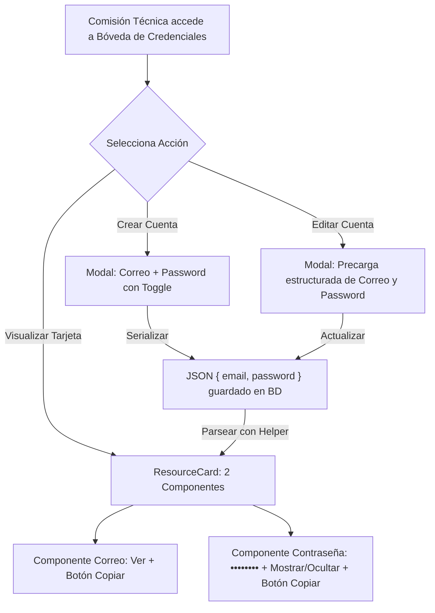

# Informe de Avance — PR23: Estandarización de Cards de Nominación, Depuración de SSO y Bóveda de Cuentas de Planillaje

**Fecha de Cierre:** 24 de Octubre de 2026  
**Proyecto:** SGAOB (Sistema de Gestión de Árbitros y Oficiales de Básquetbol)  
**Alcance:** apps/web, docs  
**Estado:** Completado y Verificado 100%

---

## 1. Resumen Ejecutivo del Hito

En este hito se implementaron refinamientos clave de interfaz de usuario, depuración de flujos obsoletos y soporte para cuentas estructuradas de planillaje:

1. **Estandarización Tipográfica en Métricas de Nominaciones:** Se actualizaron los textos secundarios de las 4 tarjetas de métricas en [`NominationsPage.tsx`](file:///c:/Users/mella/OneDrive/Documentos/Proyectos/CapstoneMain/apps/web/src/pages/NominationsPage.tsx) para capitalizar su primera letra (*"Registradas"*, *"Por confirmar"*, *"Ratificadas"*, *"Con motivo"*), mejorando la legibilidad y coherencia visual SaaS.
2. **Eliminación Total del Acceso SSO en el Portal de Autenticación:** Se removió de forma definitiva el bloque de inicio de sesión federado institucional (*"O mediante portal institucional"* y *"Ingresar mediante Portal SSO"*) en [`LoginPage.tsx`](file:///c:/Users/mella/OneDrive/Documentos/Proyectos/CapstoneMain/apps/web/src/pages/LoginPage.tsx). Cumpliendo estrictamente la **Política de Merma Cero**, se purgaron los estados locales (`cognitoConfig`), la consulta `authApi.getCognitoConfig()`, el callback OIDC hash y los imports huérfanos (`ExternalLink`, `CognitoConfigResponse`).
3. **Auditoría de Almacenamiento Web (Diagnóstico Modo Oscuro):** Se verificó que `sessionStorage` no posee uso residual y que `localStorage` se reserva exclusivamente para `sgaob_token`. Dado que el sistema únicamente invoca `removeItem('sgaob_token')` sin limpiar el almacenamiento global, se determinó la viabilidad total de persistir la preferencia de tema (`sgaob_theme`) de manera independiente a la sesión activa.
4. **Transformación de la Bóveda de Credenciales para Cuentas de Planillaje:** Se adaptó la Bóveda de Credenciales de Planillaje para representar formalmente cuentas de acceso externas (NBN23, Swish, FIBA LiveStats). La tarjeta ahora se divide en dos componentes diferenciados:
   * **Componente 1 (Correo / Usuario):** Visualización del identificador con acción de copiado directo y feedback visual.
   * **Componente 2 (Contraseña Cifrada):** Clave oculta por defecto (`••••••••`), toggle dinámico para mostrar/ocultar y botón de copiado independiente.
   * **Compatibilidad Retroactiva y Cero Migraciones:** Mediante [`credentialHelper.ts`](file:///c:/Users/mella/OneDrive/Documentos/Proyectos/CapstoneMain/apps/web/src/components/resources/credentialHelper.ts), los datos se serializan en JSON estructurado y se preserva un fallback seguro para credenciales heredadas en texto plano.

---

## 2. Archivos y Componentes Modificados

| Componente / Archivo | Tipo de Cambio | Alcance y Propósito |
|---|---|---|
| [`apps/web/src/pages/NominationsPage.tsx`](file:///c:/Users/mella/OneDrive/Documentos/Proyectos/CapstoneMain/apps/web/src/pages/NominationsPage.tsx) | Modificación | Capitalización de la primera letra en las 4 tarjetas de métricas de asignaciones. |
| [`apps/web/src/pages/LoginPage.tsx`](file:///c:/Users/mella/OneDrive/Documentos/Proyectos/CapstoneMain/apps/web/src/pages/LoginPage.tsx) | Modificación | Supresión total de la sección de inicio de sesión SSO y eliminación de merma asociada. |
| [`apps/web/src/components/resources/credentialHelper.ts`](file:///c:/Users/mella/OneDrive/Documentos/Proyectos/CapstoneMain/apps/web/src/components/resources/credentialHelper.ts) | Nuevo | Utilidades de parseo, validación y serialización de cuentas de planillaje con fallback retroactivo. |
| [`apps/web/src/components/resources/ResourceCard.tsx`](file:///c:/Users/mella/OneDrive/Documentos/Proyectos/CapstoneMain/apps/web/src/components/resources/ResourceCard.tsx) | Modificación | Implementación de 2 componentes (Correo con copia y Contraseña oculta con toggle y copia). |
| [`apps/web/src/components/resources/CreateResourceModal.tsx`](file:///c:/Users/mella/OneDrive/Documentos/Proyectos/CapstoneMain/apps/web/src/components/resources/CreateResourceModal.tsx) | Modificación | Despliegue de campos específicos de correo y contraseña al seleccionar tipo Credencial. |
| [`apps/web/src/components/resources/EditResourceModal.tsx`](file:///c:/Users/mella/OneDrive/Documentos/Proyectos/CapstoneMain/apps/web/src/components/resources/EditResourceModal.tsx) | Modificación | Desempaquetado y edición individual de correo y contraseña para cuentas de planillaje existentes. |
| [`docs/avance-pr23.md`](file:///c:/Users/mella/OneDrive/Documentos/Proyectos/CapstoneMain/docs/avance-pr23.md) | Nuevo | Informe formal de avance y cumplimiento de hitos conforme a `AGENTS.md`. |

---

## 3. Arquitectura y Flujos Técnicos



---

## 4. Trazabilidad con Requerimientos Funcionales

| Código RF | Requerimiento Funcional | Estado | Evidencia de Implementación |
|---|---|---|---|
| **RF16** | Visualización de Designaciones y Asignaciones | **Cumplido** | Cards de métricas con etiquetas capitalizadas legibles en `NominationsPage.tsx`. |
| **RF18** | Bóveda Segura de Credenciales (Anexo A.5) | **Cumplido** | Estructuración en 2 componentes (correo y contraseña oculta) con acceso reservado para CT. |
| **RF01** | Autenticación Segura y Estándar SaaS | **Cumplido** | Portal de login unificado eliminando botones y dependencias SSO no operativas. |

---

## 5. Evidencia Verificable de Funcionamiento (Protocolo Pre-Commit)

### 1. Compilación Frontend / Monorepo (`npm run build:web`)
```bash
> @sgaob/shared@1.0.0 build
> tsc
> @sgaob/web@1.0.0 build
> tsc && vite build
✓ 1676 modules transformed.
dist/index.html                                0.83 kB │ gzip:  0.44 kB
dist/assets/index-C3t6WxVG.css                45.82 kB │ gzip:  7.86 kB
dist/assets/ResourcesPage-CuIvE96k.js         36.82 kB │ gzip:  7.18 kB
dist/assets/NominationsPage-Dv9YNy9K.js       44.72 kB │ gzip:  8.98 kB
dist/assets/LoginPage--r6HY-yQ.js             17.62 kB │ gzip:  4.11 kB
✓ built in 3.83s
Resultado: Exitoso (0 errores).
```

### 2. Verificación de Tipos del Backend (`npx tsc --noEmit -p apps/api/tsconfig.json`)
```bash
Resultado: Exitoso (0 errores de TypeScript).
```

### 3. Verificación de Linter y Tipos Frontend (`npm run lint --prefix apps/web`)
```bash
> @sgaob/web@1.0.0 lint
> tsc --noEmit
Resultado: Exitoso (0 errores, 0 imports no utilizados).
```

### 4. Pruebas Unitarias de Backend (`npm run test --prefix apps/api`)
```text
Test Suites: 18 passed, 18 total
Tests:       136 passed, 136 total
Snapshots:   0 total
Time:        14.666 s
Resultado: 100% pasando (0 fallos).
```

