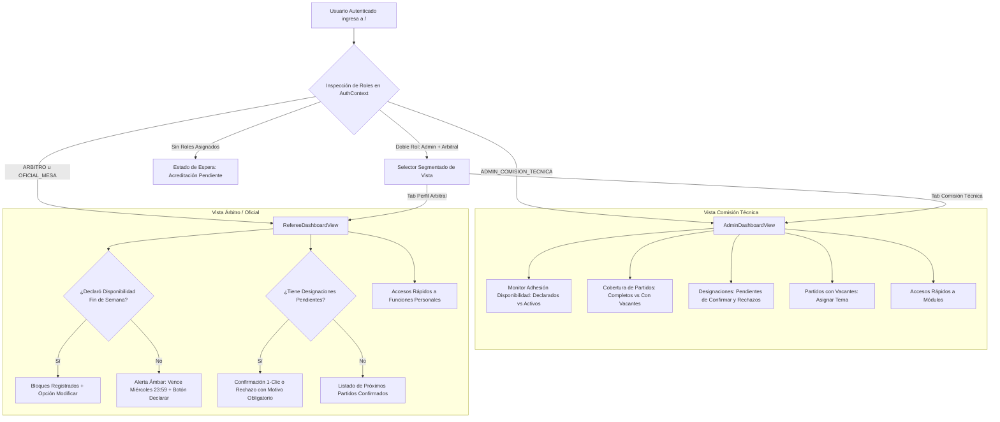

# Informe de Avance — PR24: Rediseño Modular del Dashboard Operativo y KPIs en Tiempo Real por Rol

**Fecha de Cierre:** 24 de Octubre de 2026  
**Proyecto:** SGAOB (Sistema de Gestión de Árbitros y Oficiales de Básquetbol)  
**Alcance:** apps/web, docs  
**Estado:** Completado y Verificado 100%

---

## 1. Resumen Ejecutivo del Hito

En este hito se ejecutó una reingeniería completa de la pantalla principal (Home / Dashboard), transformando un conjunto de tarjetas estáticas de baja relevancia en un **Centro de Control Operativo adaptativo por perfil de usuario**, con foco en información viva, accionable y métricas en tiempo real:

1. **Purga Total de Componentes y Datos Estáticos Irrelevantes:** Se eliminaron las tarjetas fijas de *Estado de Cuenta*, *Consentimiento de Privacidad*, *Identificador de Sistema UUID* y el bloque informativo inferior estático (*"Panel Operativo del Sistema"*), liberando espacio para información verdaderamente útil en la gestión diaria.
2. **Dashboard Operativo para la Comisión Técnica (`ADMIN_COMISION_TECNICA`):**
   * **Monitor de Disponibilidad Semanal:** Cálculo en tiempo real de adhesión semanal (árbitros y oficiales con bloques declarados vs. total de personal activo), barra de progreso visual, desglose por bloques (`FULL`, `HORARIO_1`, `HORARIO_2`, `NO`) y cuenta regresiva al cierre automático de los miércoles a las 23:59.
   * **Cobertura de Cartelera:** Métrica viva de partidos programados, distinguiendo entre encuentros con terna arbitral 100% cubierta y partidos con vacantes pendientes.
   * **Supervisión de Designaciones y Rechazos:** Conteo de nominaciones por ratificar y alerta prioritaria de rechazos (`REJECTED`) que requieren reemplazo urgente.
   * **Bandeja de Partidos que Requieren Atención:** Lista compacta de partidos con vacantes de árbitro principal, asistente u oficial de mesa, con acceso directo a completar la terna en un solo clic.
   * **Accesos Rápidos de Gestión:** Enlaces directos a Designaciones, Cartelera Oficial, Consolidado de Disponibilidad y Gestión de Usuarios.
3. **Dashboard Personal para Árbitros y Oficiales de Mesa (`ARBITRO` / `OFICIAL_MESA`):**
   * **Semáforo de Disponibilidad Semanal:** Detección automática del estado de declaración del usuario para el fin de semana del ciclo activo. Si está declarado, muestra los bloques y plazo de modificación; si está pendiente, despliega una alerta ámbar destacada con enlace directo a declarar.
   * **Confirmación Inmediata de Designaciones:** Visualización destacada de nominaciones pendientes con botones de respuesta rápida (*"Confirmar Asistencia"* con un clic y *"Rechazar..."* con modal de motivo obligatorio).
   * **Próximos Partidos Ratificados:** Tarjeta resumen con fecha, hora, recinto, categoría y rol asignado para los compromisos confirmados.
4. **Soporte Nativo para Usuarios con Doble Rol:** Si un usuario ejerce funciones de Comisión Técnica y además es árbitro u oficial activo, la cabecera ofrece un selector segmentado (*"Comisión Técnica"* vs. *"Mi Perfil Arbitral"*), permitiéndole alternar fluidamente entre la gestión de la liga y su actividad individual.
5. **Estandarización de Textos de Acción y Claridad de Botones en Todo el Frontend:**
   * **Recursos:** De *"Publicar Recurso"* a *"Nueva Publicación o Recurso..."*, y en el modal de creación textos dinámicos según tipo (*"Guardar Credencial de Planillaje"*, *"Subir y Guardar Documento"*, *"Publicar Comunicado Oficial"*).
   * **Cartelera:** De *"Nuevo Partido Manual"* a *"Crear Partido..."* (eliminando jerga técnica) y de *"Sincronizar Cartelera"* a *"Configurar Sincronización..."*.
   * **Designaciones:** De *"Actualizar"* a *"Recargar Asignaciones"*, de *"Responder"* a *"Responder Designación..."*, y en el modal de respuesta textos dinámicos (*"Confirmar Asistencia al Partido"* vs. *"Enviar Rechazo de Designación"*).
   * **Usuarios y Disponibilidad:** De *"Roles"* a *"Editar Roles..."*, de *"Estado"* a *"Cambiar Estado..."*, de *"Nuevo Usuario"* a *"Registrar Nuevo Usuario..."* y de *"Volver a hoy"* a *"Ir a Semana Actual"*.

---

## 2. Archivos y Componentes Modificados

| Componente / Archivo | Tipo de Cambio | Alcance y Propósito |
|---|---|---|
| [`apps/web/src/components/dashboard/dashboardUtils.ts`](file:///c:/Users/mella/OneDrive/Documentos/Proyectos/CapstoneMain/apps/web/src/components/dashboard/dashboardUtils.ts) | Nuevo | Utilidades de cálculo de ciclo semanal, plazos límite (miércoles 23:59) y análisis de dotación mínima arbitral. |
| [`apps/web/src/components/dashboard/AdminDashboardView.tsx`](file:///c:/Users/mella/OneDrive/Documentos/Proyectos/CapstoneMain/apps/web/src/components/dashboard/AdminDashboardView.tsx) | Nuevo | Vista especializada para la Comisión Técnica con KPIs de disponibilidad, cobertura y alertas operativas. |
| [`apps/web/src/components/dashboard/RefereeDashboardView.tsx`](file:///c:/Users/mella/OneDrive/Documentos/Proyectos/CapstoneMain/apps/web/src/components/dashboard/RefereeDashboardView.tsx) | Nuevo | Vista personalizada para árbitros y oficiales con semáforo de disponibilidad y confirmación de partidos. |
| [`apps/web/src/pages/DashboardPage.tsx`](file:///c:/Users/mella/OneDrive/Documentos/Proyectos/CapstoneMain/apps/web/src/pages/DashboardPage.tsx) | Modificación | Orquestador principal del Home, depuración de merma y soporte para selector de vista en doble rol. |
| [`apps/web/src/pages/ResourcesPage.tsx`](file:///c:/Users/mella/OneDrive/Documentos/Proyectos/CapstoneMain/apps/web/src/pages/ResourcesPage.tsx) | Modificación | Ajuste de etiquetas de botones: "Nueva Publicación o Recurso...", "Exportar Asignaciones a Excel..." y "Recargar Recursos". |
| [`apps/web/src/components/resources/CreateResourceModal.tsx`](file:///c:/Users/mella/OneDrive/Documentos/Proyectos/CapstoneMain/apps/web/src/components/resources/CreateResourceModal.tsx) | Modificación | Botón submit dinámico según tipo: Guardar Credencial, Subir Documento o Publicar Comunicado. |
| [`apps/web/src/pages/MatchesPage.tsx`](file:///c:/Users/mella/OneDrive/Documentos/Proyectos/CapstoneMain/apps/web/src/pages/MatchesPage.tsx) | Modificación | Ajuste de etiquetas: "Configurar Sincronización..." y "Crear Partido...". |
| [`apps/web/src/pages/NominationsPage.tsx`](file:///c:/Users/mella/OneDrive/Documentos/Proyectos/CapstoneMain/apps/web/src/pages/NominationsPage.tsx) | Modificación | Ajuste de etiqueta: "Recargar Asignaciones". |
| [`apps/web/src/components/nominations/NominationsTable.tsx`](file:///c:/Users/mella/OneDrive/Documentos/Proyectos/CapstoneMain/apps/web/src/components/nominations/NominationsTable.tsx) | Modificación | Ajuste de etiqueta: "Responder Designación...". |
| [`apps/web/src/components/nominations/RespondNominationModal.tsx`](file:///c:/Users/mella/OneDrive/Documentos/Proyectos/CapstoneMain/apps/web/src/components/nominations/RespondNominationModal.tsx) | Modificación | Botón submit dinámico: "Confirmar Asistencia al Partido" vs. "Enviar Rechazo de Designación". |
| [`apps/web/src/components/users/UsersTable.tsx`](file:///c:/Users/mella/OneDrive/Documentos/Proyectos/CapstoneMain/apps/web/src/components/users/UsersTable.tsx) | Modificación | Ajuste de acciones en tabla: "Editar Roles..." y "Cambiar Estado...". |
| [`apps/web/src/pages/UsersManagementPage.tsx`](file:///c:/Users/mella/OneDrive/Documentos/Proyectos/CapstoneMain/apps/web/src/pages/UsersManagementPage.tsx) | Modificación | Ajuste de etiqueta: "Registrar Nuevo Usuario..." y tooltip de recarga accesible. |
| [`apps/web/src/pages/AvailabilityPage.tsx`](file:///c:/Users/mella/OneDrive/Documentos/Proyectos/CapstoneMain/apps/web/src/pages/AvailabilityPage.tsx) | Modificación | Ajuste de navegación: "Ir a Semana Actual". |
| [`docs/avance-pr24.md`](file:///c:/Users/mella/OneDrive/Documentos/Proyectos/CapstoneMain/docs/avance-pr24.md) | Nuevo | Informe formal de avance y cumplimiento de hitos conforme a `AGENTS.md`. |

---

## 3. Arquitectura y Flujos Técnicos



---

## 4. Trazabilidad con Requerimientos Funcionales

| Código RF | Requerimiento Funcional | Estado | Evidencia de Implementación |
|---|---|---|---|
| **RF05** | Regla de Cierre de Disponibilidad Semanal | **Cumplido** | Integración de cuenta regresiva y semáforo respecto al cierre automático de los miércoles a las 23:59 hrs en [`dashboardUtils.ts`](file:///c:/Users/mella/OneDrive/Documentos/Proyectos/CapstoneMain/apps/web/src/components/dashboard/dashboardUtils.ts). |
| **RF06** | Consolidado y Monitor de Disponibilidad | **Cumplido** | Despliegue de métricas en tiempo real de adhesión de personal y desglose por bloques en [`AdminDashboardView.tsx`](file:///c:/Users/mella/OneDrive/Documentos/Proyectos/CapstoneMain/apps/web/src/components/dashboard/AdminDashboardView.tsx). |
| **RF11 / RF13** | Dotación Arbitral y Asignaciones | **Cumplido** | Detección de partidos con vacantes (falta de árbitro principal, asistente u oficial) y alerta visual para completar la terna. |
| **RF15** | Respuesta a Designaciones Técnicas | **Cumplido** | Botón de confirmación directa y modal de rechazo con validación de motivo en [`RefereeDashboardView.tsx`](file:///c:/Users/mella/OneDrive/Documentos/Proyectos/CapstoneMain/apps/web/src/components/dashboard/RefereeDashboardView.tsx). |
| **Anexo A.1** | Segregación Estricta de Roles Técnicos | **Cumplido** | Visualización diferenciada e independiente de roles de árbitro y oficial de mesa con soporte para doble rol. |

---

## 5. Evidencia Verificable de Funcionamiento (Protocolo Pre-Commit)

### 1. Compilación Frontend / Monorepo (`npm run build:web`)
```bash
> @sgaob/shared@1.0.0 build
> tsc
> @sgaob/web@1.0.0 build
> tsc && vite build
vite v5.4.21 building for production...
✓ 1679 modules transformed.
dist/index.html                                   0.83 kB │ gzip:  0.44 kB
dist/assets/index-g5grTeON.css                   47.19 kB │ gzip:  8.04 kB
dist/assets/DashboardPage-BvoahFyr.js            37.77 kB │ gzip:  7.25 kB
✓ built in 3.65s
Resultado: Exitoso (0 errores).
```

### 2. Verificación de Tipos del Backend (`npx tsc --noEmit -p apps/api/tsconfig.json`)
```bash
Resultado: Exitoso (0 errores de TypeScript).
```

### 3. Verificación de Linter y Tipos Frontend (`npm run lint --prefix apps/web`)
```bash
> @sgaob/web@1.0.0 lint
> tsc --noEmit
Resultado: Exitoso (0 errores, 0 imports huérfanos).
```

### 4. Pruebas Unitarias de Backend (`npm run test --prefix apps/api`)
```text
Test Suites: 18 passed, 18 total
Tests:       136 passed, 136 total
Snapshots:   0 total
Resultado: 100% pasando (0 fallos).
```

