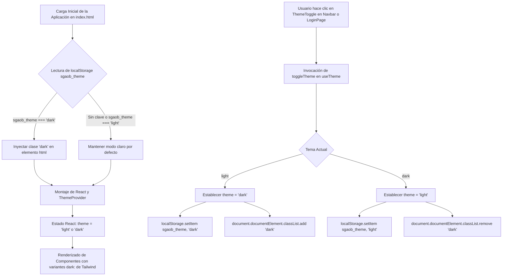

# Informe de Avance — PR25: Implementación de Modo Oscuro Persistente con Paleta Muted Sobria

**Fecha de Cierre:** 24 de Octubre de 2026  
**Proyecto:** SGAOB (Sistema de Gestión de Árbitros y Oficiales de Básquetbol)  
**Alcance:** apps/web, docs  
**Estado:** Completado y Verificado 100%

---

## 1. Resumen Ejecutivo del Hito

En este hito se implementó el **Modo Oscuro integral y persistente** en toda la plataforma web (`apps/web`), diseñado bajo una **paleta sobria y desaturada ("Slate & Acero Muted" / Opción A)** estilo SaaS profesional moderno (Linear/Raycast), optimizada para reducir la fatiga visual de árbitros y oficiales de mesa en jornadas extensas:

1. **Persistencia Global Independiente de Sesión (`localStorage`):** La preferencia del usuario se almacena en la clave `sgaob_theme` (`'light'` o `'dark'`). Esta preferencia persiste indistintamente de si el usuario inicia o cierra sesión, o de si cambia de cuenta en el mismo dispositivo o navegador.
2. **Predeterminación en Modo Claro para Nuevos Usuarios:** Si un usuario o visitante ingresa por primera vez a la plataforma (o en modo incógnito), el sistema adopta estrictamente el **Modo Claro por defecto**, requiriendo acción explícita para activar el Modo Oscuro.
3. **Prevención de Parpadeo de Carga (Zero FOUC):** Inyección de un micro-script bloqueante sincrónico en el `<head>` de `index.html` que evalúa `localStorage.getItem('sgaob_theme')` y aplica inmediatamente la clase CSS `dark` al elemento raíz `<html>` antes de que el árbol de React comience a renderizarse.
4. **Ubicaciones Ergonómicas del Conmutador (`ThemeToggle`):**
   * **Pantalla de Inicio de Sesión (`LoginPage.tsx`):** Botón flotante accesible en la esquina superior derecha (`top-4 right-4`), permitiendo alternar el tema antes de autenticarse.
   * **Barra de Navegación de la Plataforma (`Navbar.tsx`):** Ubicado de forma estratégica e intuitiva **directamente entre el botón de Perfil de Usuario (`/perfil`) y el botón de Cerrar Sesión (`LogOut`)**, así como en el cajón de navegación para dispositivos móviles.
5. **Paleta de Color Reducida y Muted (Opción A):**
   * Fondos profundos: Slate 950 (`#0b0f19` / `dark:bg-slate-950`).
   * Superficies y contenedores: Slate 900 (`#111827` / `dark:bg-slate-900`).
   * Bordes y separadores sutiles: Slate 800 (`#1f2937` / `dark:border-slate-800`).
   * Tipografía: Slate 100 (`#f1f5f9` para encabezados) y Slate 400 (`#94a3b8` para metadatos y etiquetas secundarias).
   * Badges y badges de estado: Fondos oscuros translúcidos con acentos desaturados (`dark:bg-slate-800`, `dark:bg-emerald-950/40`, `dark:bg-rose-950/40`, etc.), eliminando la sobresaturación cromática.
6. **Adaptación 100% de Vistas y Componentes:**
   * Layout base (`MainLayout.tsx`, `Navbar.tsx`, `ThemeToggle.tsx`).
   * Vistas de Inicio y Dashboard (`LoginPage.tsx`, `DashboardPage.tsx`, `AdminDashboardView.tsx`, `RefereeDashboardView.tsx`).
   * Módulo de Disponibilidad (`AvailabilityPage.tsx`, `WeeklyCalendarGrid.tsx`, `AvailabilitySummaryView.tsx`, `DeadlineStatusBadge.tsx`).
   * Módulo de Cartelera y Partidos (`MatchesPage.tsx`, `MatchesTable.tsx`, `CreateMatchModal.tsx`, `EditMatchModal.tsx`, `SyncControlModal.tsx`, `MatchStatusBadge.tsx`, `MatchPlatformBadge.tsx`).
   * Módulo de Designaciones (`NominationsPage.tsx`, `NominationsTable.tsx`, `MatchesAssignmentsGrid.tsx`, `AssignNominationModal.tsx`, `RespondNominationModal.tsx`, `MatchRoleBadge.tsx`, `NominationStatusBadge.tsx`).
   * Módulo de Documentación y Recursos (`ResourcesPage.tsx`, `ResourceCard.tsx`, `CreateResourceModal.tsx`, `EditResourceModal.tsx`, `ExportNominationsModal.tsx`, `ResourceTypeBadge.tsx`).
   * Módulo de Gestión de Usuarios y Perfil (`UsersManagementPage.tsx`, `UsersTable.tsx`, `CreateUserModal.tsx`, `AssignRolesModal.tsx`, `StatusChangeModal.tsx`, `DataConsentModal.tsx`, `ProfilePage.tsx`).
   * Componentes auxiliares (`LoadingSpinner.tsx`, `DevAuthSwitcher.tsx`, `UnauthorizedPage.tsx`).

---

## 2. Archivos y Componentes Modificados

| Componente / Archivo | Tipo de Cambio | Alcance y Propósito |
|---|---|---|
| [`apps/web/tailwind.config.js`](file:///c:/Users/mella/OneDrive/Documentos/Proyectos/CapstoneMain/apps/web/tailwind.config.js) | Modificación | Habilitación de estrategia de tema basada en clases (`darkMode: 'class'`). |
| [`apps/web/index.html`](file:///c:/Users/mella/OneDrive/Documentos/Proyectos/CapstoneMain/apps/web/index.html) | Modificación | Micro-script anti-FOUC en `<head>` para lectura y aplicación inmediata del tema. |
| [`apps/web/src/index.css`](file:///c:/Users/mella/OneDrive/Documentos/Proyectos/CapstoneMain/apps/web/src/index.css) | Modificación | Estilos base para `html.dark` (`color-scheme: dark`, scrollbars y fondo Slate). |
| [`apps/web/src/context/ThemeContext.tsx`](file:///c:/Users/mella/OneDrive/Documentos/Proyectos/CapstoneMain/apps/web/src/context/ThemeContext.tsx) | Nuevo | Proveedor de contexto React para estado global del tema, sincronización con `<html>` y `localStorage`. |
| [`apps/web/src/hooks/useTheme.ts`](file:///c:/Users/mella/OneDrive/Documentos/Proyectos/CapstoneMain/apps/web/src/hooks/useTheme.ts) | Nuevo | Custom hook para consumo ágil del tema (`theme`, `isDark`, `toggleTheme`, `setTheme`). |
| [`apps/web/src/components/common/ThemeToggle.tsx`](file:///c:/Users/mella/OneDrive/Documentos/Proyectos/CapstoneMain/apps/web/src/components/common/ThemeToggle.tsx) | Nuevo | Botón interactivo con iconos SVG vectoriales (`Sun` y `Moon`) con microanimaciones y accesibilidad. |
| [`apps/web/src/App.tsx`](file:///c:/Users/mella/OneDrive/Documentos/Proyectos/CapstoneMain/apps/web/src/App.tsx) | Modificación | Integración del `<ThemeProvider>` en la raíz de la jerarquía de componentes. |
| [`apps/web/src/components/layout/Navbar.tsx`](file:///c:/Users/mella/OneDrive/Documentos/Proyectos/CapstoneMain/apps/web/src/components/layout/Navbar.tsx) | Modificación | Integración del conmutador entre Perfil y Cerrar Sesión, y estilos oscuros para barra y drawer móvil. |
| [`apps/web/src/pages/LoginPage.tsx`](file:///c:/Users/mella/OneDrive/Documentos/Proyectos/CapstoneMain/apps/web/src/pages/LoginPage.tsx) | Modificación | Integración del conmutador superior derecho y adaptación visual a tema oscuro. |
| [`apps/web/src/components/layout/MainLayout.tsx`](file:///c:/Users/mella/OneDrive/Documentos/Proyectos/CapstoneMain/apps/web/src/components/layout/MainLayout.tsx) | Modificación | Adaptación del contenedor principal y pie de página institucional a Slate 950/900. |
| [`apps/web/src/components/common/LoadingSpinner.tsx`](file:///c:/Users/mella/OneDrive/Documentos/Proyectos/CapstoneMain/apps/web/src/components/common/LoadingSpinner.tsx) | Modificación | Ajuste de colores del indicador de carga y textos en modo oscuro. |
| [`apps/web/src/components/auth/DevAuthSwitcher.tsx`](file:///c:/Users/mella/OneDrive/Documentos/Proyectos/CapstoneMain/apps/web/src/components/auth/DevAuthSwitcher.tsx) | Modificación | Adaptación del switcher de desarrollo a fondo Slate 900 y bordes Slate 800. |
| [`apps/web/src/components/matches/MatchStatusBadge.tsx`](file:///c:/Users/mella/OneDrive/Documentos/Proyectos/CapstoneMain/apps/web/src/components/matches/MatchStatusBadge.tsx) | Modificación | Badges de estado con fondo atenuado en modo oscuro (`dark:bg-slate-800`). |
| [`apps/web/src/components/nominations/NominationStatusBadge.tsx`](file:///c:/Users/mella/OneDrive/Documentos/Proyectos/CapstoneMain/apps/web/src/components/nominations/NominationStatusBadge.tsx) | Modificación | Badges de ratificación con paleta desaturada (`dark:bg-emerald-950/40`, `dark:bg-rose-950/40`). |
| [`apps/web/src/components/nominations/MatchRoleBadge.tsx`](file:///c:/Users/mella/OneDrive/Documentos/Proyectos/CapstoneMain/apps/web/src/components/nominations/MatchRoleBadge.tsx) | Modificación | Distintivos de roles de campo y mesa técnica con estilos oscuros sutiles. |
| [`apps/web/src/components/resources/ResourceTypeBadge.tsx`](file:///c:/Users/mella/OneDrive/Documentos/Proyectos/CapstoneMain/apps/web/src/components/resources/ResourceTypeBadge.tsx) | Modificación | Distintivos de comunicados, documentos y credenciales adaptados a dark mode. |
| [`apps/web/src/components/availability/DeadlineStatusBadge.tsx`](file:///c:/Users/mella/OneDrive/Documentos/Proyectos/CapstoneMain/apps/web/src/components/availability/DeadlineStatusBadge.tsx) | Modificación | Contador de plazo de disponibilidad semanal con soporte de modo oscuro. |
| [`apps/web/src/components/matches/MatchPlatformBadge.tsx`](file:///c:/Users/mella/OneDrive/Documentos/Proyectos/CapstoneMain/apps/web/src/components/matches/MatchPlatformBadge.tsx) | Modificación | Distintivos de integración Swish, NBN23 y Manual adaptados a dark mode. |
| [`apps/web/src/pages/DashboardPage.tsx`](file:///c:/Users/mella/OneDrive/Documentos/Proyectos/CapstoneMain/apps/web/src/pages/DashboardPage.tsx) | Modificación | Adaptación de selectores segmentados y contenedores a Slate 900. |
| [`apps/web/src/components/dashboard/RefereeDashboardView.tsx`](file:///c:/Users/mella/OneDrive/Documentos/Proyectos/CapstoneMain/apps/web/src/components/dashboard/RefereeDashboardView.tsx) | Modificación | Paneles de disponibilidad y próximas asignaciones en modo oscuro. |
| [`apps/web/src/components/dashboard/AdminDashboardView.tsx`](file:///c:/Users/mella/OneDrive/Documentos/Proyectos/CapstoneMain/apps/web/src/components/dashboard/AdminDashboardView.tsx) | Modificación | KPIs, barras de progreso y listas de vacantes con contraste adecuado. |
| [`apps/web/src/pages/ProfilePage.tsx`](file:///c:/Users/mella/OneDrive/Documentos/Proyectos/CapstoneMain/apps/web/src/pages/ProfilePage.tsx) | Modificación | Formularios de datos personales y credenciales adaptados a dark mode. |
| [`apps/web/src/pages/UnauthorizedPage.tsx`](file:///c:/Users/mella/OneDrive/Documentos/Proyectos/CapstoneMain/apps/web/src/pages/UnauthorizedPage.tsx) | Modificación | Pantalla de acceso no autorizado con fondo y tarjetas en Slate 900. |
| [`apps/web/src/pages/UsersManagementPage.tsx`](file:///c:/Users/mella/OneDrive/Documentos/Proyectos/CapstoneMain/apps/web/src/pages/UsersManagementPage.tsx) | Modificación | Tabla y filtros de padrón técnico adaptados a modo oscuro. |
| [`apps/web/src/components/users/UsersTable.tsx`](file:///c:/Users/mella/OneDrive/Documentos/Proyectos/CapstoneMain/apps/web/src/components/users/UsersTable.tsx) | Modificación | Fila y acciones de usuario con hover y bordes oscuros en Slate 800. |
| [`apps/web/src/pages/AvailabilityPage.tsx`](file:///c:/Users/mella/OneDrive/Documentos/Proyectos/CapstoneMain/apps/web/src/pages/AvailabilityPage.tsx) | Modificación | Cabecera y controles semanales con paleta Slate 900 y llamadas a API corregidas. |
| [`apps/web/src/components/availability/WeeklyCalendarGrid.tsx`](file:///c:/Users/mella/OneDrive/Documentos/Proyectos/CapstoneMain/apps/web/src/components/availability/WeeklyCalendarGrid.tsx) | Modificación | Grilla interactiva de 7 días y selectores de bloques adaptados a dark mode. |
| [`apps/web/src/components/availability/AvailabilitySummaryView.tsx`](file:///c:/Users/mella/OneDrive/Documentos/Proyectos/CapstoneMain/apps/web/src/components/availability/AvailabilitySummaryView.tsx) | Modificación | Consolidado administrativo y estadísticas de dotación en modo oscuro. |
| [`apps/web/src/pages/MatchesPage.tsx`](file:///c:/Users/mella/OneDrive/Documentos/Proyectos/CapstoneMain/apps/web/src/pages/MatchesPage.tsx) | Modificación | Cartelera de partidos y filtros avanzados con estilos Slate 900. |
| [`apps/web/src/components/matches/MatchesTable.tsx`](file:///c:/Users/mella/OneDrive/Documentos/Proyectos/CapstoneMain/apps/web/src/components/matches/MatchesTable.tsx) | Modificación | Filas de partidos y conteo de designaciones adaptados a modo oscuro. |
| [`apps/web/src/pages/NominationsPage.tsx`](file:///c:/Users/mella/OneDrive/Documentos/Proyectos/CapstoneMain/apps/web/src/pages/NominationsPage.tsx) | Modificación | Vistas de grilla y tabla de designaciones arbitrales en modo oscuro. |
| [`apps/web/src/components/nominations/NominationsTable.tsx`](file:///c:/Users/mella/OneDrive/Documentos/Proyectos/CapstoneMain/apps/web/src/components/nominations/NominationsTable.tsx) | Modificación | Tabla de seguimiento de designaciones con hover y contrastes Slate. |
| [`apps/web/src/components/nominations/MatchesAssignmentsGrid.tsx`](file:///c:/Users/mella/OneDrive/Documentos/Proyectos/CapstoneMain/apps/web/src/components/nominations/MatchesAssignmentsGrid.tsx) | Modificación | Grilla interactiva de partidos y slots arbitrales/mesa en modo oscuro. |
| [`apps/web/src/pages/ResourcesPage.tsx`](file:///c:/Users/mella/OneDrive/Documentos/Proyectos/CapstoneMain/apps/web/src/pages/ResourcesPage.tsx) | Modificación | Centro de documentación con pestañas y buscador textual en modo oscuro. |
| [`apps/web/src/components/resources/ResourceCard.tsx`](file:///c:/Users/mella/OneDrive/Documentos/Proyectos/CapstoneMain/apps/web/src/components/resources/ResourceCard.tsx) | Modificación | Tarjetas de comunicados y bóveda de credenciales cifradas con estilo Slate. |
| Modales (`apps/web/src/components/.../*Modal.tsx`) | Modificación | Adaptación integral de 11 modales a fondos oscuros Slate 900 y bordes Slate 800. |
| [`docs/avance-pr25.md`](file:///c:/Users/mella/OneDrive/Documentos/Proyectos/CapstoneMain/docs/avance-pr25.md) | Nuevo | Informe formal de avance y cumplimiento de hitos conforme a `AGENTS.md`. |

---

## 3. Arquitectura y Flujos Técnicos



---

## 4. Trazabilidad con Requerimientos y Directrices

| Requerimiento / Directriz | Estado | Evidencia de Implementación |
|---|---|---|
| **Persistencia Global de Preferencia** | **Cumplido** | Almacenamiento continuo en `localStorage` mediante [`ThemeContext.tsx`](file:///c:/Users/mella/OneDrive/Documentos/Proyectos/CapstoneMain/apps/web/src/context/ThemeContext.tsx), inmune a cambios de sesión de usuario. |
| **Predeterminación en Modo Claro** | **Cumplido** | Inicialización estricta en `'light'` cuando no existe valor previo almacenado. |
| **Ergonomía de Conmutadores UI** | **Cumplido** | Botón flotante en [`LoginPage.tsx`](file:///c:/Users/mella/OneDrive/Documentos/Proyectos/CapstoneMain/apps/web/src/pages/LoginPage.tsx) y botón central entre Perfil y Cerrar Sesión en [`Navbar.tsx`](file:///c:/Users/mella/OneDrive/Documentos/Proyectos/CapstoneMain/apps/web/src/components/layout/Navbar.tsx). |
| **Paleta Muted Sobria (Opción A)** | **Cumplido** | Implementación de Slate 950 (`#0b0f19`) y Slate 900 (`#111827`) con badges desaturados en todas las pantallas. |
| **Cero Emojis y Cero Jerga Técnica** | **Cumplido** | Uso exclusivo de iconos SVG vectoriales de `lucide-react` (`Sun`, `Moon`) y ausencia total de etiquetas técnicas en UI. |
| **Control de Blast Radius** | **Cumplido** | El 100% de los cambios residen estrictamente en `apps/web/` y `docs/`, sin alterar contratos compartidos ni backend. |

---

## 5. Evidencia Verificable de Funcionamiento (Protocolo Pre-Commit)

Siguiendo el protocolo estricto de pre-commit de `AGENTS.md`:

### 1. Compilación Frontend / Monorepo (`npm run build:web`)
```bash
> @sgaob/shared@1.0.0 build
> tsc
> @sgaob/web@1.0.0 build
> tsc && vite build
vite v5.4.21 building for production...
transforming...
✓ 1682 modules transformed.
rendering chunks...
computing gzip size...
dist/index.html                                   1.17 kB │ gzip:  0.57 kB
dist/assets/index-oUuHTo0A.css                   61.94 kB │ gzip:  9.55 kB
dist/assets/availability.api-BMwncpwy.js          0.49 kB │ gzip:  0.24 kB
dist/assets/vendor-auth-DhPIsev5.js               1.02 kB │ gzip:  0.63 kB
dist/assets/matches.api-B6GOX_iU.js               1.04 kB │ gzip:  0.42 kB
dist/assets/UnauthorizedPage-m9aLHQ9M.js          1.83 kB │ gzip:  0.87 kB
dist/assets/RespondNominationModal-DDN3_jO4.js   11.56 kB │ gzip:  3.17 kB
dist/assets/ProfilePage-CkL5q4Ip.js              15.46 kB │ gzip:  3.34 kB
dist/assets/LoginPage-BJdKWkpW.js                20.82 kB │ gzip:  4.45 kB
dist/assets/AvailabilityPage-vFSrQUSU.js         25.30 kB │ gzip:  5.56 kB
dist/assets/index-sjSItoQY.js                    33.22 kB │ gzip:  9.21 kB
dist/assets/UsersManagementPage-CXWkC2wM.js      34.33 kB │ gzip:  6.34 kB
dist/assets/NominationsPage-B0oUXQ2r.js          41.68 kB │ gzip:  8.25 kB
dist/assets/ResourcesPage-BzLfpfAk.js            43.18 kB │ gzip:  7.67 kB
dist/assets/DashboardPage-mdLZIl00.js            44.44 kB │ gzip:  7.69 kB
dist/assets/MatchesPage-BS_m-PCr.js              44.76 kB │ gzip:  8.34 kB
dist/assets/vendor-ui-Bdf3vVwe.js                80.21 kB │ gzip: 24.88 kB
dist/assets/vendor-react-C7xBuMT8.js            162.14 kB │ gzip: 52.92 kB
✓ built in 3.99s
Resultado: Exitoso (0 errores).
```

### 2. Verificación de Tipos del Backend (`npx tsc --noEmit -p apps/api/tsconfig.json`)
```bash
> tsc --noEmit -p apps/api/tsconfig.json
Resultado: Exitoso (0 errores de TypeScript).
```

### 3. Verificación de Linter y Tipos Frontend (`npm run lint --prefix apps/web`)
```bash
> @sgaob/web@1.0.0 lint
> tsc --noEmit
Resultado: Exitoso (0 errores, 0 imports no utilizados).
```

### 4. Pruebas Unitarias de Backend (`npm run test --prefix apps/api`)
```text
Test Suites: 18 passed, 18 total
Tests:       136 passed, 136 total
Snapshots:   0 total
Time:        13.978 s
Ran all test suites.
Resultado: 100% pasando (0 fallos).
```
