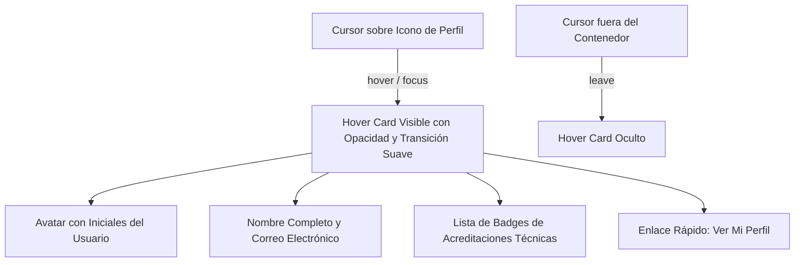
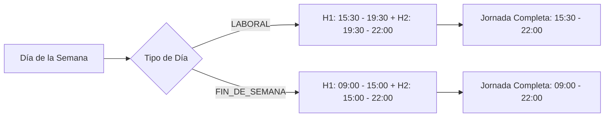

# Informe de Avance — PR26: Optimización Ergonómica de Navbar con Hover Card, Parametrización Horaria en Disponibilidad y Depuración de Enums Técnicos

**Fecha de Cierre:** 24 de Octubre de 2026  
**Proyecto:** SGAOB (Sistema de Gestión de Árbitros y Oficiales de Básquetbol)  
**Alcance:** apps/web, docs  
**Estado:** Completado y Verificado 100%

---

## 1. Resumen Ejecutivo del Hito

En este hito se implementaron mejoras visuales y de usabilidad orientadas a una experiencia SaaS profesional y pulida en `apps/web`, atendiendo a los puntos observados en sesiones de alta demanda:

1. **Descongestión del Navbar y Hover Card de Perfil (`Navbar.tsx`):** Se eliminó el bloque horizontal que exponía de forma fija el nombre, correo y badges de roles, el cual generaba sobrecarga y desbordes en cuentas con múltiples roles y enlaces activos (Comisión Técnica). En su lugar, se integró un componente flotante interactivo (*Hover Card / Popover*) adherido al botón de perfil del usuario, mostrando ordenadamente el avatar por iniciales, datos de contacto, badges de roles y un enlace de acceso directo al perfil completo.
2. **Parametrización Horaria Continua y Nomenclatura Formal en Disponibilidad (`WeeklyCalendarGrid.tsx`):**
   * En la opción *Jornada Completa*, se reemplazó el texto genérico `H1 + H2 disponible` por el cálculo dinámico del rango horario total (`${h1.startTime} - ${h2.endTime}`): **`15:30 - 22:00`** para días hábiles y **`09:00 - 22:00`** para fines de semana, acompañado del icono de reloj y tipografía monoespaciada idéntica a las opciones individuales.
   * Se sustituyó la etiqueta informal y coloquial `Finde` por la denominación formal **`Fin de Semana`**, y `Laboral` por **`Día Hábil`**.
3. **Depuración de Enums Técnicos en Estado de Cuenta (`StatusChangeModal.tsx`):** Se removieron las definiciones en mayúsculas `(ACTIVE)`, `(INACTIVE)` y `(PENDING_ROLE)` de las opciones seleccionables del modal, presentando exclusivamente nombres limpios y profesionales (`Activo`, `Inactivo`, `Pendiente de Rol`) junto con sus descripciones explicativas.

---

## 2. Archivos y Componentes Modificados

| Componente / Archivo | Tipo de Cambio | Alcance y Propósito |
|---|---|---|
| [`apps/web/src/components/layout/Navbar.tsx`](file:///c:/Users/mella/OneDrive/Documentos/Proyectos/CapstoneMain/apps/web/src/components/layout/Navbar.tsx) | Modificación | Sustitución del slot horizontal de perfil por un *Hover Card* moderno con transición suave, datos del usuario, badges de roles y enlace a `/perfil`. |
| [`apps/web/src/components/availability/WeeklyCalendarGrid.tsx`](file:///c:/Users/mella/OneDrive/Documentos/Proyectos/CapstoneMain/apps/web/src/components/availability/WeeklyCalendarGrid.tsx) | Modificación | Despliegue del rango de horas completo (`15:30 - 22:00` / `09:00 - 22:00`) en *Jornada Completa* y reemplazo de badges por `Día Hábil` y `Fin de Semana`. |
| [`apps/web/src/components/users/StatusChangeModal.tsx`](file:///c:/Users/mella/OneDrive/Documentos/Proyectos/CapstoneMain/apps/web/src/components/users/StatusChangeModal.tsx) | Modificación | Eliminación de las cadenas técnicas `(ACTIVE)`, `(INACTIVE)` y `(PENDING_ROLE)` en las opciones de cambio de estado. |
| [`docs/avance-pr26.md`](file:///c:/Users/mella/OneDrive/Documentos/Proyectos/CapstoneMain/docs/avance-pr26.md) | Nuevo | Informe formal de avance y cumplimiento de hitos conforme a las directrices de `AGENTS.md`. |

---

## 3. Arquitectura y Flujos Técnicos

### Flujo de Interacción del Hover Card de Perfil



### Cálculo Dinámico de Rango Horario en Jornada Completa



---

## 4. Trazabilidad con Requerimientos Funcionales y Estándares UX

| Código RF / Directriz | Requerimiento / Estándar | Estado | Evidencia de Implementación |
|---|---|---|---|
| **RF02 / Anexo A.1** | Gestión de Usuarios y Roles Técnicos | **Cumplido** | Hover card refleja exactamente las acreditaciones técnicas del usuario autenticado sin saturar el Navbar. |
| **RF05 / Anexo A.4** | Bloques Horarios Parametrizados | **Cumplido** | Jornada completa muestra el lapso horario dinámico calculado a partir de `TimeBlockConfig` (`15:30 - 22:00` en días hábiles). |
| **Directriz PR19** | Cero Etiquetas Técnicas en UI | **Cumplido** | Depuración de enums `(ACTIVE)`, `(INACTIVE)` y `(PENDING_ROLE)` en `StatusChangeModal.tsx`. |
| **Ergonomía UI/UX** | Diseño SaaS Profesional Standalone | **Cumplido** | Reemplazo de jerga informal `Finde` por `Fin de Semana` y `Día Hábil`. |

---

## 5. Evidencia Verificable de Funcionamiento (Protocolo Pre-Commit)

Siguiendo el protocolo estricto de pre-commit de `AGENTS.md`:

### 1. Compilación Frontend / Monorepo (`npm run build:web`)
```bash
> @sgaob/shared@1.0.0 build
> tsc
> @sgaob/web@1.0.0 build
> tsc && vite build
vite v5.4.21 building for production...
transforming...
✓ 1682 modules transformed.
rendering chunks...
computing gzip size...
dist/index.html                                   1.17 kB │ gzip:  0.57 kB
dist/assets/index-CU4FnJAD.css                   62.66 kB │ gzip:  9.69 kB
dist/assets/availability.api-BFTqtKuv.js          0.49 kB │ gzip:  0.24 kB
dist/assets/vendor-auth-DhPIsev5.js               1.02 kB │ gzip:  0.63 kB
dist/assets/matches.api-BQLumiUD.js               1.04 kB │ gzip:  0.42 kB
dist/assets/UnauthorizedPage-NSbitlJO.js          1.83 kB │ gzip:  0.87 kB
dist/assets/RespondNominationModal-CyAjiFt1.js   11.56 kB │ gzip:  3.17 kB
dist/assets/ProfilePage-Du7Edc9k.js              15.46 kB │ gzip:  3.34 kB
dist/assets/LoginPage-Czfn2hP9.js                20.82 kB │ gzip:  4.45 kB
dist/assets/AvailabilityPage-D6p7gqrU.js         25.64 kB │ gzip:  5.62 kB
dist/assets/UsersManagementPage-BuBeij9F.js      34.30 kB │ gzip:  6.32 kB
dist/assets/index-DQgLd5Cp.js                    34.43 kB │ gzip:  9.48 kB
dist/assets/NominationsPage-BB7sCybS.js          41.68 kB │ gzip:  8.25 kB
dist/assets/ResourcesPage-GtlADVH0.js            43.18 kB │ gzip:  7.67 kB
dist/assets/DashboardPage-DFF8lrM9.js            44.44 kB │ gzip:  7.69 kB
dist/assets/MatchesPage-9LXV6b5v.js              44.76 kB │ gzip:  8.34 kB
dist/assets/vendor-ui-Bdf3vVwe.js                80.21 kB │ gzip: 24.88 kB
dist/assets/vendor-react-C7xBuMT8.js            162.14 kB │ gzip: 52.92 kB
✓ built in 3.68s
Resultado: Exitoso (0 errores).
```

### 2. Verificación de Tipos del Backend (`npx tsc --noEmit -p apps/api/tsconfig.json`)
```bash
> tsc --noEmit -p apps/api/tsconfig.json
Resultado: Exitoso (0 errores de TypeScript).
```

### 3. Verificación de Linter y Tipos Frontend (`npm run lint --prefix apps/web`)
```bash
> @sgaob/web@1.0.0 lint
> tsc --noEmit
Resultado: Exitoso (0 errores, 0 imports no utilizados).
```

### 4. Pruebas Unitarias de Backend (`npm run test --prefix apps/api`)
```text
Test Suites: 18 passed, 18 total
Tests:       136 passed, 136 total
Snapshots:   0 total
Time:        12.217 s
Ran all test suites.
Resultado: 100% pasando (0 fallos).
```

