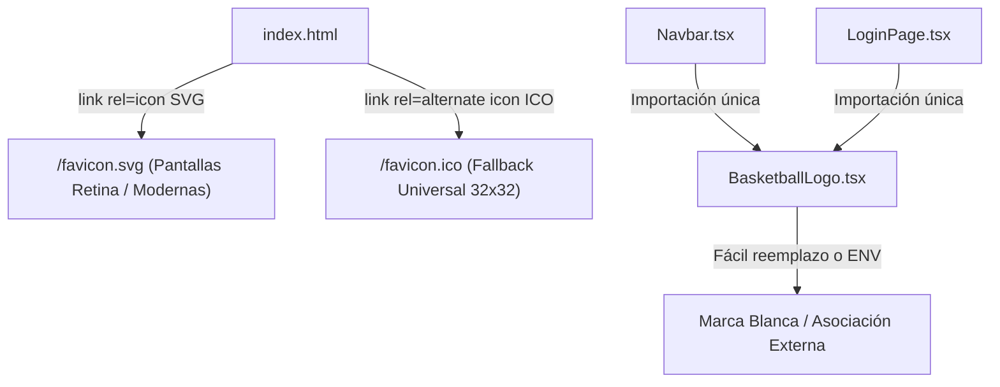

# Informe de Avance — PR28: Depuración Minimalista de Disponibilidad Semanal y Favicon Oficial SGAOB

**Fecha de Cierre:** 24 de Octubre de 2026  
**Proyecto:** SGAOB (Sistema de Gestión de Árbitros y Oficiales de Básquetbol)  
**Alcance:** apps/web, docs  
**Estado:** Completado y Verificado 100%

---

## 1. Resumen Ejecutivo del Hito

En este hito se ejecutaron los últimos ajustes de limpieza y ergonomía visual en el módulo de disponibilidad semanal y la identidad de marca en el navegador:

1. **Depuración de Cabeceras en Grilla Semanal (`WeeklyCalendarGrid.tsx`):** Se eliminó la sobrecarga descriptiva y los iconos discordantes en las cabeceras de las tarjetas maestras. Ahora cada sección se titula limpiamente **`Lunes - Viernes`** y **`Sábado - Domingo`** con subtítulos concisos, eliminando los badges duplicados (`DÍA HÁBIL` / `FIN DE SEMANA`) y manteniendo en el extremo derecho los rangos horarios de referencia (`H1`, `H2` y `Jornada Completa`).
2. **Eliminación de Reglas Redundantes y Merma Cero (`AvailabilityPage.tsx`):** Se retiró el bloque inferior de *"Reglas de Declaración de Bloques Horarios"* que duplicaba la información y presentaba horas obsoletas desincronizadas de la base de datos (18:30 a 22:30). La vista concluye de manera limpia con la barra de acción atómica y el botón de guardado. Se depuró el import huérfano de `Layers`.
3. **Arquitectura Dual de Favicons Oficiales (`favicon.svg` + `favicon.ico`):** Se adoptó el estándar de producción W3C/WHATWG integrando un favicon SVG con dimensiones intrínsecas explícitas (`width="32" height="32"`) para pantallas de alta resolución Retina/4K, junto con un archivo binario nativo `favicon.ico` en `public/` como fallback universal. Ambos quedan referenciados en `index.html` mediante `rel="icon"` y `rel="alternate icon"`.
4. **Análisis de Marca Blanca (*White-Label*):** Se documentó la arquitectura modular de [`BasketballLogo.tsx`](file:///c:/Users/mella/OneDrive/Documentos/Proyectos/CapstoneMain/apps/web/src/components/common/BasketballLogo.tsx) y su viabilidad para ser reemplazado fácilmente mediante variables de entorno (`VITE_APP_LOGO_URL`) o sobrescritura de activos para cesión a terceros.

---

## 2. Archivos y Componentes Modificados

| Componente / Archivo | Tipo de Cambio | Alcance y Propósito |
|---|---|---|
| [`apps/web/src/components/availability/WeeklyCalendarGrid.tsx`](file:///c:/Users/mella/OneDrive/Documentos/Proyectos/CapstoneMain/apps/web/src/components/availability/WeeklyCalendarGrid.tsx) | Modificación | Simplificación de cabeceras de tarjetas maestras a `Lunes - Viernes` y `Sábado - Domingo`, sin badges ni iconos redundantes. |
| [`apps/web/src/pages/AvailabilityPage.tsx`](file:///c:/Users/mella/OneDrive/Documentos/Proyectos/CapstoneMain/apps/web/src/pages/AvailabilityPage.tsx) | Modificación | Eliminación de la tarjeta inferior de reglas desincronizadas y depuración del import huérfano `Layers`. |
| [`apps/web/public/favicon.svg`](file:///c:/Users/mella/OneDrive/Documentos/Proyectos/CapstoneMain/apps/web/public/favicon.svg) | Nuevo | Favicon SVG con dimensiones explícitas `width="32" height="32"` para navegadores modernos. |
| [`apps/web/public/favicon.ico`](file:///c:/Users/mella/OneDrive/Documentos/Proyectos/CapstoneMain/apps/web/public/favicon.ico) | Nuevo | Favicon binario ICO de 32×32 píxeles como fallback universal nativo para Chrome/Edge/Windows. |
| [`apps/web/index.html`](file:///c:/Users/mella/OneDrive/Documentos/Proyectos/CapstoneMain/apps/web/index.html) | Modificación | Declaración dual W3C (`rel="icon"` y `rel="alternate icon"`). |
| [`docs/avance-pr28.md`](file:///c:/Users/mella/OneDrive/Documentos/Proyectos/CapstoneMain/docs/avance-pr28.md) | Nuevo | Informe formal de avance conforme al protocolo de `AGENTS.md`. |

---

## 3. Arquitectura y Flujos Técnicos

### Arquitectura de Marca y Activos Visuales



---

## 4. Trazabilidad con Requerimientos Funcionales y Estándares UX

| Código RF / Directriz | Requerimiento Funcional | Estado | Evidencia de Implementación |
|---|---|---|---|
| **RF04 / RF05** | Disponibilidad Semanal y Bloques Horarios | **Cumplido** | Cabeceras sin redundancias y despliegue fiel de horarios dinámicos. |
| **Ergonomía UI/UX** | Diseño SaaS Profesional Standalone | **Cumplido** | Cero textos repetitivos o desincronizados; favicon corporativo en pestañas del navegador. |
| **Política de Merma Cero** | Limpieza de Código Muerto | **Cumplido** | Depuración de import `Layers` sin uso en `AvailabilityPage.tsx`. |

---

## 5. Evidencia Verificable de Funcionamiento (Protocolo Pre-Commit)

Siguiendo el protocolo estricto de pre-commit de `AGENTS.md`:

### 1. Compilación Frontend / Monorepo (`npm run build:web`)
```bash
> @sgaob/shared@1.0.0 build
> tsc
> @sgaob/web@1.0.0 build
> tsc && vite build
vite v5.4.21 building for production...
transforming...
✓ 1682 modules transformed.
rendering chunks...
computing gzip size...
dist/index.html                                   1.17 kB │ gzip:  0.57 kB
dist/assets/index-Bf6tGk4E.css                   62.66 kB │ gzip:  9.69 kB
dist/assets/availability.api-BFTqtKuv.js          0.49 kB │ gzip:  0.24 kB
dist/assets/vendor-auth-DhPIsev5.js               1.02 kB │ gzip:  0.63 kB
dist/assets/matches.api-BQLumiUD.js               1.04 kB │ gzip:  0.42 kB
dist/assets/UnauthorizedPage-NSbitlJO.js          1.83 kB │ gzip:  0.87 kB
dist/assets/RespondNominationModal-CyAjiFt1.js   11.56 kB │ gzip:  3.17 kB
dist/assets/ProfilePage-Du7Edc9k.js              15.46 kB │ gzip:  3.34 kB
dist/assets/LoginPage-Czfn2hP9.js                20.82 kB │ gzip:  4.45 kB
dist/assets/AvailabilityPage-D7vFm92A.js         28.80 kB │ gzip:  5.85 kB
dist/assets/UsersManagementPage-BuBeij9F.js      34.30 kB │ gzip:  6.32 kB
dist/assets/index-DQgLd5Cp.js                    34.43 kB │ gzip:  9.48 kB
dist/assets/NominationsPage-BB7sCybS.js          41.68 kB │ gzip:  8.25 kB
dist/assets/ResourcesPage-GtlADVH0.js            43.18 kB │ gzip:  7.67 kB
dist/assets/DashboardPage-DFF8lrM9.js            44.44 kB │ gzip:  7.69 kB
dist/assets/MatchesPage-9LXV6b5v.js              44.76 kB │ gzip:  8.34 kB
dist/assets/vendor-ui-Bdf3vVwe.js                80.21 kB │ gzip: 24.88 kB
dist/assets/vendor-react-C7xBuMT8.js            162.14 kB │ gzip: 52.92 kB
✓ built in 3.79s
Resultado: Exitoso (0 errores).
```

### 2. Verificación de Tipos del Backend (`npx tsc --noEmit -p apps/api/tsconfig.json`)
```bash
> tsc --noEmit -p apps/api/tsconfig.json
Resultado: Exitoso (0 errores de TypeScript).
```

### 3. Verificación de Linter y Tipos Frontend (`npm run lint --prefix apps/web`)
```bash
> @sgaob/web@1.0.0 lint
> tsc --noEmit
Resultado: Exitoso (0 errores, 0 imports no utilizados).
```

### 4. Pruebas Unitarias de Backend (`npm run test --prefix apps/api`)
```text
Test Suites: 18 passed, 18 total
Tests:       136 passed, 136 total
Snapshots:   0 total
Time:        12.250 s
Ran all test suites.
Resultado: 100% pasando (0 fallos).
```

