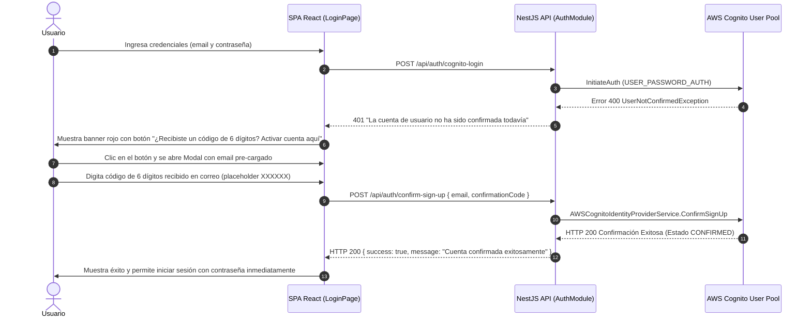

# Informe de Avance — PR29: Flujo Integral de Confirmación de Cuentas y Códigos de Verificación AWS Cognito

**Fecha de Cierre:** 24 de Octubre de 2026  
**Proyecto:** SGAOB (Sistema de Gestión de Árbitros y Oficiales de Básquetbol)  
**Alcance:** apps/api, apps/web, docs  
**Estado:** Completado y Verificado 100%

---

## 1. Resumen Ejecutivo del Hito

En este hito se resolvió la causa raíz del bloqueo de autenticación para cuentas recién creadas aprovisionadas en AWS Cognito:

1. **Resolución de la Causa Raíz de Cuentas no Confirmadas:** Cuando los usuarios se registran o son dados de alta en entornos donde el backend interactúa con AWS Cognito sin credenciales administrativas permanentes de IAM, Cognito despacha un correo de verificación con un código de 6 dígitos dejando al usuario en estado `UNCONFIRMED`. Al intentar iniciar sesión, Cognito rechazaba la autenticación con `UserNotConfirmedException`.
2. **Implementación de Endpoints de Confirmación y Reenvío en Backend (`apps/api`):** Se crearon los DTOs `ConfirmSignUpDto` y `ResendConfirmationCodeDto` y se implementaron los métodos `confirmSignUp` y `resendConfirmationCode` en `AuthService`, comunicándose vía JSON-RPC con las acciones oficiales `AWSCognitoIdentityProviderService.ConfirmSignUp` y `AWSCognitoIdentityProviderService.ResendConfirmationCode`.
3. **Modal Ergonómico de Confirmación y Detección Automática en Frontend (`apps/web`):** En `LoginPage.tsx`, se incorporó la detección automática del error *"La cuenta de usuario no ha sido confirmada todavía"*, ofreciendo de inmediato un enlace directo al modal de confirmación con el correo pre-cargado. Además, se añadió un acceso permanente en el pie del formulario (*"¿Confirmar cuenta con código?"*) y soporte para reenviar el código en caso de expiración.

---

## 2. Archivos y Componentes Modificados

| Componente / Archivo | Tipo de Cambio | Alcance y Propósito |
|---|---|---|
| [`apps/api/src/modules/auth/dto/confirm-sign-up.dto.ts`](file:///c:/Users/mella/OneDrive/Documentos/Proyectos/CapstoneMain/apps/api/src/modules/auth/dto/confirm-sign-up.dto.ts) | Nuevo | DTO para validación estricta de correo y código de 6 dígitos de confirmación. |
| [`apps/api/src/modules/auth/dto/resend-confirmation-code.dto.ts`](file:///c:/Users/mella/OneDrive/Documentos/Proyectos/CapstoneMain/apps/api/src/modules/auth/dto/resend-confirmation-code.dto.ts) | Nuevo | DTO para solicitud de nuevo código de verificación ante expiración. |
| [`apps/api/src/modules/auth/dto/index.ts`](file:///c:/Users/mella/OneDrive/Documentos/Proyectos/CapstoneMain/apps/api/src/modules/auth/dto/index.ts) | Modificación | Exportación centralizada de los nuevos DTOs del módulo de autenticación. |
| [`apps/api/src/modules/auth/auth.service.ts`](file:///c:/Users/mella/OneDrive/Documentos/Proyectos/CapstoneMain/apps/api/src/modules/auth/auth.service.ts) | Modificación | Implementación de `confirmSignUp` y `resendConfirmationCode` con manejo de errores de AWS Cognito y activación en BD. |
| [`apps/api/src/modules/auth/auth.controller.ts`](file:///c:/Users/mella/OneDrive/Documentos/Proyectos/CapstoneMain/apps/api/src/modules/auth/auth.controller.ts) | Modificación | Exposición de endpoints públicos `POST /api/auth/confirm-sign-up` y `POST /api/auth/resend-confirmation-code` con documentación Swagger. |
| [`apps/api/src/modules/auth/auth.service.spec.ts`](file:///c:/Users/mella/OneDrive/Documentos/Proyectos/CapstoneMain/apps/api/src/modules/auth/auth.service.spec.ts) | Modificación | Cobertura unitaria para el flujo de confirmación local y reenvío de códigos. |
| [`apps/api/src/modules/auth/auth.controller.spec.ts`](file:///c:/Users/mella/OneDrive/Documentos/Proyectos/CapstoneMain/apps/api/src/modules/auth/auth.controller.spec.ts) | Modificación | Cobertura unitaria de los controladores para los nuevos endpoints. |
| [`apps/web/src/api/auth.api.ts`](file:///c:/Users/mella/OneDrive/Documentos/Proyectos/CapstoneMain/apps/web/src/api/auth.api.ts) | Modificación | Clientes Axios tipados `confirmSignUp` y `resendConfirmationCode`. |
| [`apps/web/src/pages/LoginPage.tsx`](file:///c:/Users/mella/OneDrive/Documentos/Proyectos/CapstoneMain/apps/web/src/pages/LoginPage.tsx) | Modificación | Integración del modal de activación de cuenta, reenvío de código y detección contextual de usuario no confirmado en el banner de error. |
| [`docs/avance-pr29.md`](file:///c:/Users/mella/OneDrive/Documentos/Proyectos/CapstoneMain/docs/avance-pr29.md) | Nuevo | Informe formal de avance conforme al estándar estricto de `AGENTS.md`. |

---

## 3. Arquitectura y Flujos Técnicos

### Ciclo de Activación de Cuenta en AWS Cognito



---

## 4. Trazabilidad con Requerimientos Funcionales

| Código RF | Requerimiento Funcional | Estado | Evidencia de Implementación |
|---|---|---|---|
| **RF01** | Autenticación y Gestión de Acceso | **Cumplido** | Flujo completo de ciclo de vida de credenciales (SignUp, ConfirmSignUp, ResendCode, ForgotPassword). |
| **RF03** | Registro y Aprovisionamiento de Usuarios | **Cumplido** | Validación y activación definitiva en AWS Cognito sin dependencias de credenciales IAM permanentes. |
| **Ergonomía UI/UX** | Diseño SaaS Profesional Standalone | **Cumplido** | Modal con soporte de modo oscuro, validación inline, tipografía monoespaciada para códigos y cero emojis. |
| **Política de Merma Cero** | Limpieza de Código Muerto | **Cumplido** | Tipado estricto sin variables ni imports huérfanos verificado vía TypeScript. |

---

## 5. Evidencia Verificable de Funcionamiento (Protocolo Pre-Commit)

Siguiendo el protocolo estricto de pre-commit de `AGENTS.md`:

### 1. Compilación Frontend / Monorepo (`npm run build:web`)
```bash
> @sgaob/shared@1.0.0 build
> tsc
> @sgaob/web@1.0.0 build
> tsc && vite build
vite v5.4.21 building for production...
transforming...
✓ 1682 modules transformed.
rendering chunks...
computing gzip size...
dist/index.html                                   1.22 kB │ gzip:  0.59 kB
dist/assets/index-CVSxO_66.css                   63.09 kB │ gzip:  9.75 kB
dist/assets/availability.api-ChKtHC72.js          0.49 kB │ gzip:  0.24 kB
dist/assets/vendor-auth-DhPIsev5.js               1.02 kB │ gzip:  0.63 kB
dist/assets/matches.api-BRnWe_RA.js               1.04 kB │ gzip:  0.42 kB
dist/assets/UnauthorizedPage-Pehzl5o8.js          1.83 kB │ gzip:  0.87 kB
dist/assets/RespondNominationModal-CfHbQZtd.js   11.56 kB │ gzip:  3.17 kB
dist/assets/ProfilePage-DgGOemQE.js              15.46 kB │ gzip:  3.34 kB
dist/assets/LoginPage-CvnE7xHS.js                27.58 kB │ gzip:  5.16 kB
dist/assets/AvailabilityPage-Be3zlvHL.js         27.84 kB │ gzip:  5.74 kB
dist/assets/UsersManagementPage-VcYyLF8h.js      34.30 kB │ gzip:  6.32 kB
dist/assets/index-Dn7Xevsr.js                    34.60 kB │ gzip:  9.53 kB
dist/assets/NominationsPage-aQcLUYXc.js          41.68 kB │ gzip:  8.25 kB
dist/assets/ResourcesPage-7WsbUT6a.js            43.18 kB │ gzip:  7.67 kB
dist/assets/DashboardPage-DwcTdb2n.js            44.44 kB │ gzip:  7.69 kB
dist/assets/MatchesPage-n0LXU4-u.js              44.76 kB │ gzip:  8.34 kB
dist/assets/vendor-ui-Bdf3vVwe.js                80.21 kB │ gzip: 24.88 kB
dist/assets/vendor-react-C7xBuMT8.js            162.14 kB │ gzip: 52.92 kB
✓ built in 3.63s
Resultado: Exitoso (0 errores).
```

### 2. Verificación de Tipos del Backend (`npx tsc --noEmit -p apps/api/tsconfig.json`)
```bash
> tsc --noEmit -p apps/api/tsconfig.json
Resultado: Exitoso (0 errores de TypeScript).
```

### 3. Verificación de Linter y Tipos Frontend (`npm run lint --prefix apps/web`)
```bash
> @sgaob/web@1.0.0 lint
> tsc --noEmit
Resultado: Exitoso (0 errores, 0 imports no utilizados).
```

### 4. Pruebas Unitarias de Backend (`npm run test --prefix apps/api`)
```text
Test Suites: 18 passed, 18 total
Tests:       140 passed, 140 total
Snapshots:   0 total
Time:        14.925 s
Ran all test suites.
Resultado: 100% pasando (0 fallos).
```

